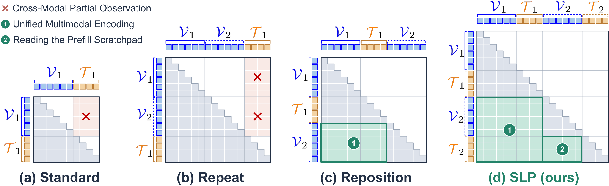

# Second-Look Prompting

[](https://second-look-vlm.com)
[](https://arxiv.org/abs/2611.30909)
[](https://second-look-vlm.com/assets/video/slp-explainer.mp4)

Code for **Replay Before You Reply: Second-Look Prompting for Unified Multimodal Encoding**.

[Yicheng Zhang\*](https://zycccishere.github.io/), Xun Zhang\*, Jingyuan Ma\*, Tianyu Yu†, Yuan Yao†



*Causal attention across input presentations: rows are querying tokens and columns are keys. Under
the standard prompt (a) and plain image repetition (b), visual tokens cannot attend to the question.
SLP (d) repeats the image–question pair, so the second image is encoded under the question (1) and
the second question reads the added visual tokens as a prefill scratchpad (2).*

Under causal attention, a token in a Vision-Language Model can attend only to what precedes it, so
whichever modality comes first is encoded without seeing the rest of the input. Second-Look
Prompting (SLP) is a training-free input presentation that repeats the image–question pair: the
standard prompt ⟨V, T⟩ becomes ⟨V, T, V, T⟩. In the repeated copy, every visual and textual token
attends to the complete input, giving a unified multimodal encoding of the pair.

This repository is built on [VLMEvalKit](https://github.com/open-compass/VLMEvalKit) and contains
the replay model wrappers, the experiment configurations of the paper, the attention-intervention
probes and the latency benchmark.

## Installation

Two Python environments cover all models. The configurations look them up as
`$CONDA_ROOT/envs/<name>/bin/python`.

| Environment | Python | vLLM | Models |
|---|---|---|---|
| `vlmeval017` | 3.10 | 0.17.1 | Qwen2.5-VL, MiniCPM-V 4.5, MiniCPM-o 4.5, Gemma-3 |
| `vlmeval031` | 3.12 | 0.31.0 (CUDA 12.9) | Qwen3.8, Qwen3.5-MoE, Gemma-4 |

```bash
git clone https://github.com/zycccishere/second-look-prompting.git
cd second-look-prompting
export CONDA_ROOT=/path/to/environments

uv venv --python 3.10 "$CONDA_ROOT/envs/vlmeval017"
VIRTUAL_ENV="$CONDA_ROOT/envs/vlmeval017" uv pip install \
  -r requirements.txt -r environments/vlmeval017.txt

uv venv --python 3.12 "$CONDA_ROOT/envs/vlmeval031"
VIRTUAL_ENV="$CONDA_ROOT/envs/vlmeval031" uv pip install \
  -r requirements.txt -r environments/vlmeval031.txt \
  --extra-index-url https://download.pytorch.org/whl/cu129 --index-strategy unsafe-best-match
```

Conda environments with the same names and the pinned packages in `environments/` work as well.

## Setup

```bash
export MODEL_ROOT=/path/to/models          # checkpoints, see the table below
export LMUData=/path/to/LMUData            # benchmarks are downloaded here on first use
mkdir -p "$LMUData"
export PYTHONPATH="$PWD"
export VLMEVAL_LAZY_INIT=1 VLMEVAL_VLM_MINIMAL_IMPORT=1 VLMEVAL_API_MINIMAL_IMPORT=1
export OPENAI_API_KEY_JUDGE=...            # judge for LLM-scored benchmarks
export OPENAI_API_KEY="$OPENAI_API_KEY_JUDGE"
export OPENAI_API_BASE_JUDGE=https://api.openai.com/v1
export OPENAI_API_BASE="$OPENAI_API_BASE_JUDGE"
```

`.env.example` lists the same variables. Checkpoints are read from `$MODEL_ROOT/<directory>`,
using the Hugging Face repository names:

| Model | Directory |
|---|---|
| Qwen2.5-VL 3B / 7B / 32B / 72B | `Qwen2.5-VL-3B-Instruct`, `Qwen2.5-VL-7B-Instruct`, `Qwen2.5-VL-32B-Instruct`, `Qwen2.5-VL-72B-Instruct` |
| MiniCPM-V 4.5 / MiniCPM-o 4.5 | `MiniCPM-V-4_5`, `MiniCPM-o-4_5` |
| Gemma-3-IT 4B / 12B / 27B | `gemma-3-4b-it`, `gemma-3-12b-it`, `gemma-3-27b-it` |
| Qwen3.8-27B, Qwen3.5-35B-A3B, Gemma-4-E4B-it | `Qwen3.8-27B`, `Qwen3.5-35B-A3B`, `gemma-4-E4B-it` |

## Input formats

Each configuration lists its input formats as replay modes:

| Mode | Input |
|---|---|
| `image_text` | ⟨V, T⟩, the standard prompt |
| `image_text_image_text` | ⟨V, T, V, T⟩, SLP |
| `image_text_text` | ⟨V, T, T⟩, question repeated |
| `image_text_image` | ⟨V, T, V⟩ |
| `image_image_text_text` | ⟨V, V, T, T⟩, same tokens as SLP in a different order |
| `text_image_text` | ⟨T, V, T⟩ |
| `image_text_filler_text` | ⟨V, T, filler, T⟩ with a text block (dots or spaces) |
| `image_text_image_image_text`, `image_text_image_image_image_text` | two or three images between the question copies |

Image transforms replace the added images: `blank` (a white image) and `noise_image_seed17`
(a noise image); `v2_tokens_half` and `v2_tokens_quarter` give the second image half or a
quarter of its visual-token budget.

## Running the experiments

Every experiment is a matrix of models × benchmarks × input formats under `configs/paper/`. Run
the launcher with either environment activated; each job then starts in the environment that its
model entry names.

```bash
EXPERIMENT=main-table
bash scripts/run_benchmark.sh \
  --matrix-config configs/paper/$EXPERIMENT/matrix.yaml \
  --model-config configs/paper/$EXPERIMENT/models.yaml \
  --task-manifest configs/paper/$EXPERIMENT/tasks.csv \
  --scheduler gpu_pool
```

`tasks.csv` lists the exact model × benchmark × format cells of the experiment; pass a subset of
its rows to run part of it. The scheduler packs jobs onto the GPUs listed in `node_gpu_ids` of
`matrix.yaml`.

| `EXPERIMENT` | Contents |
|---|---|
| `main-table` | Main results: 9 open-source models × 12 benchmarks, ⟨V, T⟩ and SLP |
| `default-controls` | ⟨V, T⟩, ⟨V, T, T⟩, dots filler, SLP and SLP with a blank or noise second image on 6 benchmarks |
| `minicpm-controls` | MiniCPM-o 4.5: ⟨V, T, V⟩, SLP and one to three blank images |
| `spaces` | Length-matched spaces filler on 6 benchmarks |
| `vvtt-qwen`, `vvtt-gemma`, `vvtt-minicpm` | ⟨V, V, T, T⟩ order control on 6 benchmarks |
| `tvt-minicpm` | ⟨T, V, T⟩ on 12 benchmarks |
| `new-models` | Qwen3.5-35B-A3B and Gemma-4-E4B-it on 6 benchmarks |
| `qwen38-baselines` | Qwen3.8-27B, ⟨V, T⟩ and SLP on 5 benchmarks |
| `effort` | Qwen3.8-27B at `low`, `medium` and `xhigh` reasoning effort, ⟨V, T⟩ and SLP on 5 benchmarks |
| `lowres-qwen25`, `lowres-qwen38` | SLP with the second image at half or a quarter of its visual tokens |

The 12 main benchmarks are DynaMath, MATH-Vision, LogicVista, VisualPuzzles, MMMU (single-image
subset), MathVista (testmini), We-Math, AI2D, OCRBench, SEED-Bench-2-Plus, MMBench and MMStar; the
6-benchmark experiments use MATH-Vision, LogicVista, DynaMath, AI2D, OCRBench and MMBench. The Qwen3.8
experiments use MATH-Vision, BabyVision, RealWorldQA, ERQA (single-image) and CharXiv (reasoning).
LLM-scored benchmarks use GPT-4o-mini as the judge.

### Collecting scores

```bash
python -m vlmeval.cli.collect_matrix_results \
  --matrix-config configs/paper/$EXPERIMENT/matrix.yaml \
  --model-config configs/paper/$EXPERIMENT/models.yaml \
  --task-manifest configs/paper/$EXPERIMENT/tasks.csv \
  --out-dir results/summary
```

### Blocking the second image from the first copy

The intervention masks the second image's attention to the first image–question pair during
standard generation, on LogicVista with Qwen2.5-VL-32B. It runs in the `vlmeval031` environment:

```bash
CUDA_VISIBLE_DEVICES=0,1 python -m vlmeval.probes.run_generation_attention \
  --dataset LogicVista --model "$MODEL_ROOT/Qwen2.5-VL-32B-Instruct" \
  --output results/logicvista/shard-0 --offset 0 --limit 447 \
  --tp 2 --batch-size 16 --max-model-len 32768 --max-batched-tokens 8192 \
  --max-tokens 2048 --gpu-memory-utilization .85 --seed 20261109 \
  --logprobs 0 --conditions slp,no_write,vtt

CUDA_VISIBLE_DEVICES='' python -m vlmeval.probes.score_generation_attention \
  --root results/logicvista --dataset LogicVista --nproc 512
```

### Latency

`tools/materialize_latency.py` fills the model, interpreter, output, cache and `$LMUData` paths
into a latency template:

```bash
python tools/materialize_latency.py \
  --template configs/paper/latency/qwen25.json \
  --model "$MODEL_ROOT/Qwen2.5-VL-32B-Instruct" \
  --python "$CONDA_ROOT/envs/vlmeval017/bin/python" \
  --output /path/to/latency-results --cache /path/to/node-local-cache \
  --write /path/to/latency-config.json
python scripts/latency_test.py --config /path/to/latency-config.json
```

For Qwen3.8-27B use `configs/paper/latency/qwen38.json` with its checkpoint and the `vlmeval031`
environment.

## Citation

```bibtex
@article{zhang2026replay,
  title   = {Replay Before You Reply: Second-Look Prompting for Unified Multimodal Encoding},
  author  = {Zhang, Yicheng and Zhang, Xun and Ma, Jingyuan and Yu, Tianyu and Yao, Yuan},
  journal = {arXiv preprint arXiv:2611.30909},
  url     = {https://arxiv.org/abs/2611.30909},
  year    = {2026}
}
```

## License

Apache License 2.0, inherited from VLMEvalKit. See `LICENSE` and `NOTICE`.
